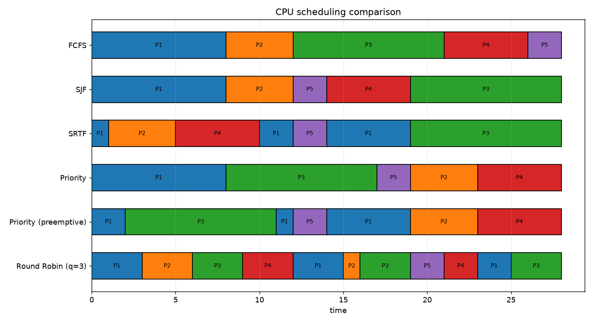

# OS Algorithms Simulator
[](https://github.com/damir126/os-simulator/actions/workflows/ci.yml)

> **Course:** Operating Systems (3rd year)

A command-line simulator for the core algorithms of an operating system:
**CPU scheduling**, **page replacement** and **deadlock avoidance**.
It prints Gantt charts and metrics, compares algorithms, and can draw the result as an image.



## Algorithms

| Area | Algorithms |
|---|---|
| CPU scheduling | FCFS, SJF, SRTF (preemptive SJF), Priority, Preemptive Priority, Round Robin |
| Page replacement | FIFO, LRU, Optimal (Belady), Clock (second chance) |
| Deadlock | Banker's algorithm: safety check and resource requests |

Metrics: waiting time, turnaround time, response time, CPU utilization, throughput, context switches.

## Usage

```bash
python -m ossim cpu examples/processes.csv --quantum 3 --png gantt.png
```

```
===== FCFS =====
|       P1       |   P2   |        P3        |    P4    | P5 |
0                8       12                 21         26   28

===== Comparison =====
algorithm                 avg wait   avg TAT  avg resp  switches
SRTF                           6.0      11.6       3.8         6
SJF                            7.0      12.6       7.0         4
FCFS                           9.8      15.4       9.8         4
Priority                       9.8      15.4       9.8         4
Priority (preemptive)          9.8      15.4       7.6         6
Round Robin (q=3)             13.4      19.0       3.8        10
```

```bash
python -m ossim paging "7 0 1 2 0 3 0 4 2 3 0 3 2" --frames 3 --algo lru
```

```
ref      7   0   1   2   0   3   0   4   2   3   0   3   2
frame0   7   7   7   2   2   2   2   4   4   4   0   0   0
frame1   .   0   0   0   0   0   0   0   0   3   3   3   3
frame2   .   .   1   1   1   3   3   3   2   2   2   2   2
fault    *   *   *   *       *       *   *   *   *
LRU: 9 page faults, hit ratio 0.308
```

```bash
python -m ossim banker examples/banker.json
```

```
SAFE state. Safe sequence: P1 -> P3 -> P4 -> P0 -> P2
Request P1 [1, 0, 2]: GRANTED
Request P0 [0, 2, 0]: DENIED (would be unsafe / must wait)
```

## Conclusions from the experiments

- **SRTF** gives the lowest average waiting time, but needs more context switches and can starve long jobs.
- **Round Robin** has the best response time (good for interactive systems) but the worst turnaround.
- **FCFS** suffers from the *convoy effect*: short jobs wait behind a long one.
- **Belady's anomaly** is reproduced in the tests: FIFO with 4 frames makes *more* faults than with 3.
- LRU is close to the optimal algorithm; Clock is a cheap approximation of LRU used by real kernels.

## Tests

```bash
python -m unittest discover -s tests -v
```

The tests use the classic textbook examples (Silberschatz, *Operating System Concepts*), so
the numbers can be checked by hand.
